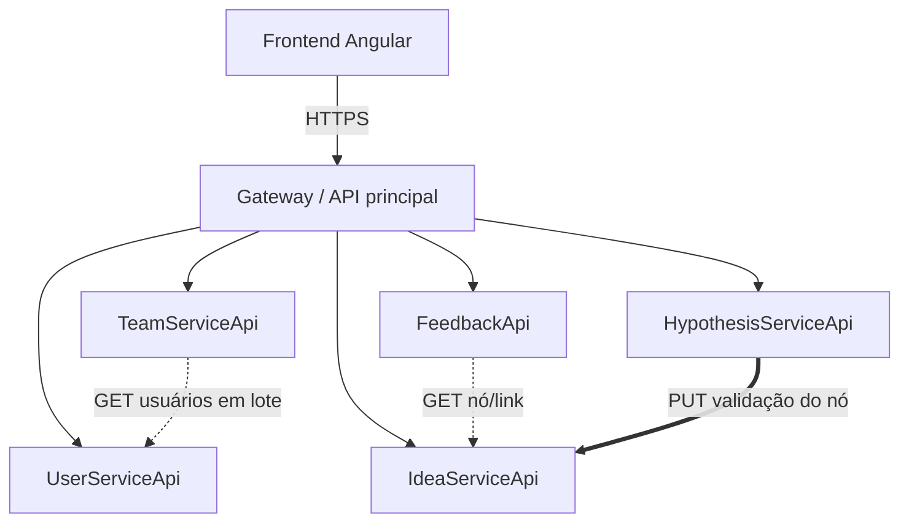
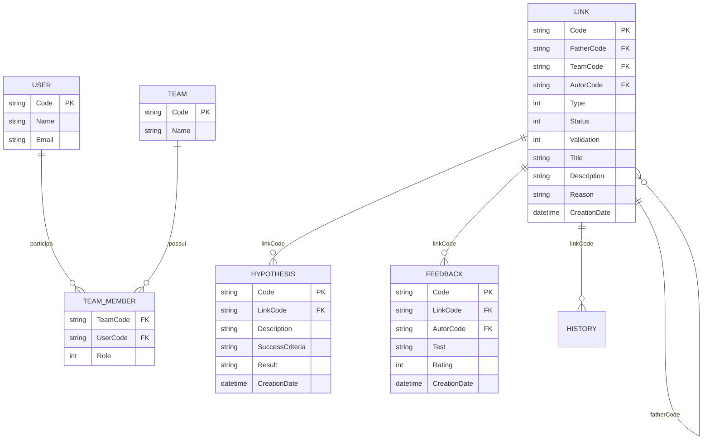

# Arquitetura

O Branchstorm segue uma arquitetura de **microsserviços**: cada serviço tem seu próprio banco
SQLite, expõe uma API REST e só conversa com os outros por HTTP. O frontend Angular fala
exclusivamente com o **gateway**.



As setas finas representam chamadas do gateway. As tracejadas são **leituras** entre serviços; a
linha grossa é a única **escrita** entre serviços: Hipóteses atualiza a validação do nó em Ideias.

## Serviços

| Serviço              | Responsabilidade                                             | Porta |
| -------------------- | ------------------------------------------------------------ | ----- |
| `UserServiceApi`     | Pessoas: cadastro, consulta e listagem                       | 5252  |
| `TeamServiceApi`     | Equipes, membros e papéis                                    | 5236  |
| `IdeaServiceApi`     | Árvore de ideias: nós, status, validação e histórico         | 5221  |
| `HypothesisServiceApi` | Hipóteses e resultados                                     | 5001\* |
| `FeedbackApi`        | Feedback e notas                                             | 5002\* |
| `BranchstormApi`     | Gateway: ponto de entrada único do backend                   | 5000\* |

\* Portas previstas; confirme em `Properties/launchSettings.json` de cada serviço.

## Modelo de dados

Cada serviço tem seu banco. As referências entre serviços são **códigos**, não chaves estrangeiras
físicas.



## Padrão interno dos serviços

Todos os serviços seguem o template visto em sala:

```text
Controller  →  Service  →  Repository  →  SQLite (Dapper)
     ↑             ↑
   DTO/Request   Result<T>
```

- **Controller** — valida a entrada, traduz HTTP e devolve `Result<T>`.
- **Service** — regras de negócio e orquestração.
- **Repository** — SQL com Dapper e `IDatabaseConnection`.
- **Request/Result** — contratos de entrada e saída, sem expor entidades.

O frontend replica essa separação em escala Angular — veja
[Frontend em camadas](./frontend.md).

## Integrações

### Hipóteses → Ideias (escrita)

Ao registrar o resultado de uma hipótese, o `HypothesisServiceApi` chama
`PUT /api/idea/{code}/validation` no `IdeaServiceApi` para atualizar a validação do nó e registrar
o evento no histórico. Essa é a integração que garante o **RF09**.

### Feedback → Ideias (leitura)

Antes de salvar, o `FeedbackApi` consulta o nó no `IdeaServiceApi` para confirmar que ele existe e
está **aberto**. Se o nó não existir ou não aceitar feedback, a requisição é rejeitada.

### Equipes → Usuários (leitura)

Para exibir membros, o `TeamServiceApi` consulta os usuários em lote no `UserServiceApi`. No
frontend, o `TeamsStore` complementa os dados com o `UserDirectoryStore`.

## Gateway

O gateway é o **único ponto de entrada** do backend para o Angular. Ele:

- roteia `/api/user`, `/api/team`, `/api/idea`, `/api/hypothesis` e `/api/feedbacks`;
- centraliza CORS, correlation id e tratamento de erros;
- evita que o frontend conheça as portas internas dos serviços.

:::caution Estado atual do backend
O gateway ainda é o scaffold `WeatherForecast`. O frontend está pronto para consumir o contrato
descrito em [Contrato da API](./api.md); enquanto o gateway não é implementado, o
[modo demonstração](./demonstracao.md) cobre todos os fluxos.
:::

## Decisões de arquitetura

| Decisão                          | Motivo                                                              |
| -------------------------------- | ------------------------------------------------------------------- |
| Um banco por serviço             | Isolamento e evolução independente, como no template da disciplina  |
| Comunicação REST síncrona        | Simplicidade e aderência ao escopo acadêmico                        |
| Gateway único                    | Reduz acoplamento do frontend e centraliza preocupações transversais |
| Códigos como referências         | Evita chaves estrangeiras entre bancos                              |
| Histórico imutável               | Preserva o “porquê” de cada decisão, inspirado no Git               |

## Evolução prevista

- Migrar de SQLite por serviço para **PostgreSQL** com um banco e um usuário por serviço.
- Trocar a integração síncrona Hipóteses → Ideias por **mensageria** (evento
  `HypothesisResultRegistered`), com consumo idempotente.
- Adicionar **observabilidade**: logs estruturados, health checks e correlation id em todos os
  serviços.
- Implementar autenticação real no gateway, substituindo o cabeçalho provisório `X-User-Code`.
