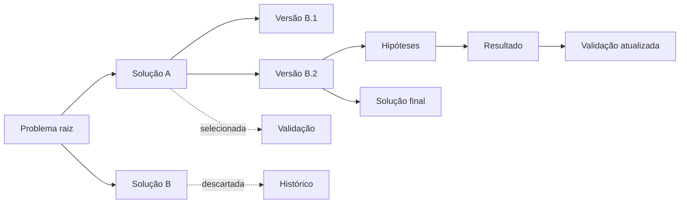

# Branchstorm

**Um brainstorm que se ramifica.**

O nome junta *branch* (ramo, como no Git) com *brainstorm* (avalanche de ideias): uma plataforma
colaborativa para evoluir e validar ideias. Cada problema vira a raiz de uma árvore — pessoas
propõem soluções, comentam, testam hipóteses e a equipe seleciona versões até chegar a uma solução
final, com todo o caminho registrado.

A inspiração é o Git: cada mudança fica registrada. Nada é apagado, nem mesmo os caminhos
descartados.

## O problema

Estudantes e equipes costumam ter muitas ideias para um mesmo problema, mas perdem o histórico de
**por que** uma alternativa foi escolhida e as outras foram abandonadas. Ferramentas de quadro
branco guardam o resultado, não a decisão. Ferramentas de debate guardam argumentos, não a evolução
das soluções.

O Branchstorm resolve isso combinando, em uma única plataforma:

- árvore **problema → soluções → versões**;
- seleção de um caminho com descarte automático dos irmãos;
- hipóteses com critério de sucesso e resultado que atualiza a validação do nó;
- feedback e nota em cada nó aberto;
- histórico de cada decisão, com autor, motivo e data.

## Fluxo principal

1. **Registrar o problema** — a raiz da árvore (RF03).
2. **Propor soluções e versões** — nós filhos, sempre com motivo (RF04).
3. **Testar hipóteses** — critérios de sucesso e resultados (RF07, RF08).
4. **Selecionar e finalizar** — o caminho escolhido vira o selecionado; os irmãos são descartados
   (RF05).
5. **Avaliar** — feedback e notas nos nós abertos (RF10, RF11).

## Perfis de usuário

| Perfil          | O que faz                                                                   |
| --------------- | --------------------------------------------------------------------------- |
| Autor           | Cria o problema/ideia raiz e propõe soluções e versões                      |
| Colaborador     | Membro da equipe que propõe soluções, cria hipóteses e comenta              |
| Avaliador       | Comenta e dá nota nas ideias; pode ser convidado para uma equipe            |
| Administrador   | Gerencia a equipe, membros e papéis                                         |
| Dono            | Criador da equipe, com privilégios administrativos                          |

Os papéis de equipe implementados são `Administrador`, `Dono`, `Colaborador` e `Avaliador`
(RF02).

## O que já está pronto

O frontend em Angular cobre **RF01–RF11** e pode ser navegado por inteiro sem backend, graças ao
modo demonstração com dados semeados. A documentação de engenharia explica como cada camada se
organiza e como conectar os serviços reais.

- [Como executar o projeto](./execucao.md)
- [Requisitos funcionais RF01–RF11](./requisitos.md)
- [Arquitetura distribuída](./arquitetura.md)
- [Frontend em camadas](./frontend.md)

## Contexto acadêmico

Projeto final da disciplina de **Arquitetura de Software (Sistemas Distribuídos —
microsserviços)** do curso de Engenharia de Software do **Centro Universitário SATC**, orientado
pelo professor **Eduardo Cizeski Meneghel**.

Equipe: `Pedro Pavei`, `Matheus Cechinel` e `Thales Vaz`.
